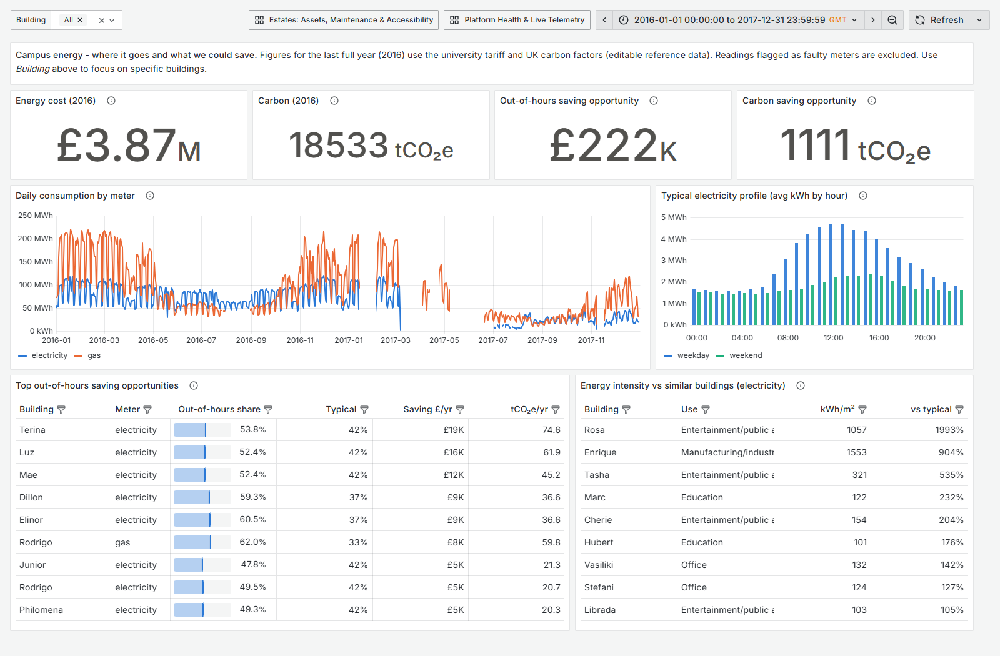
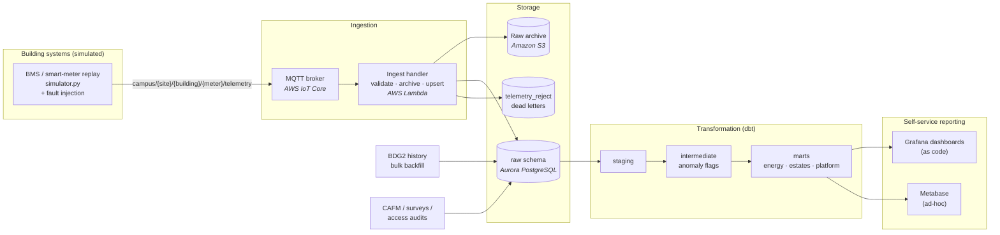
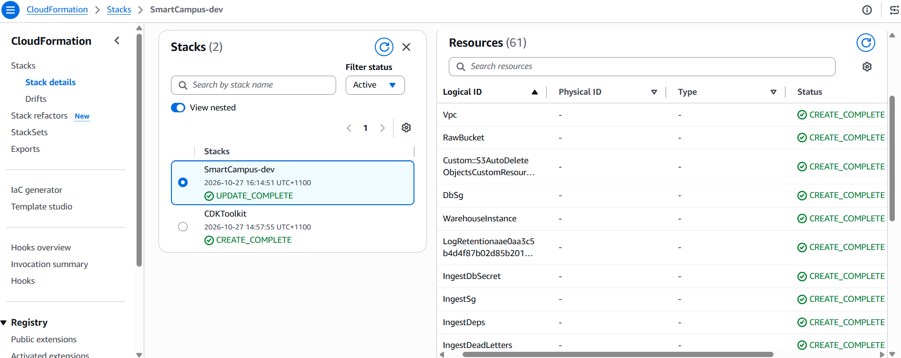
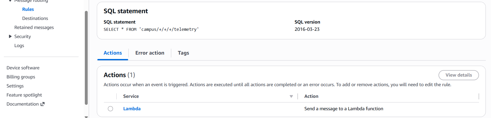
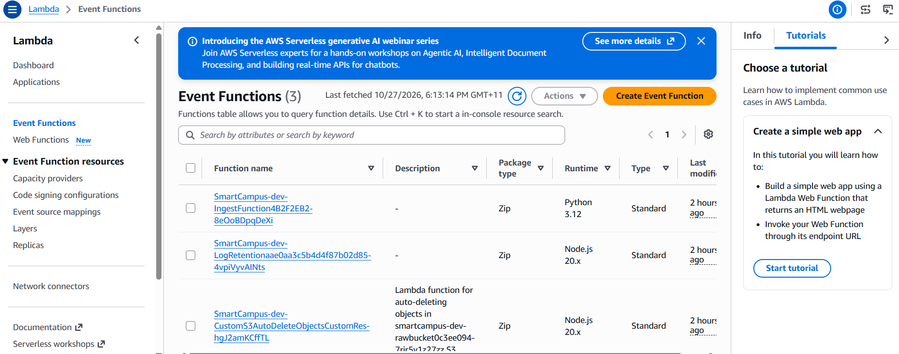
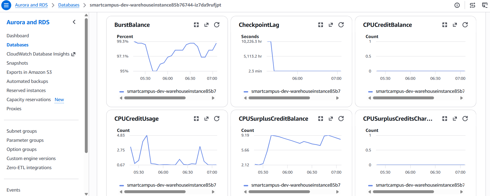
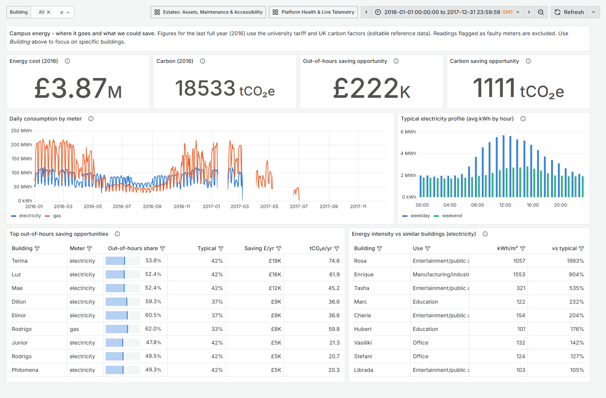
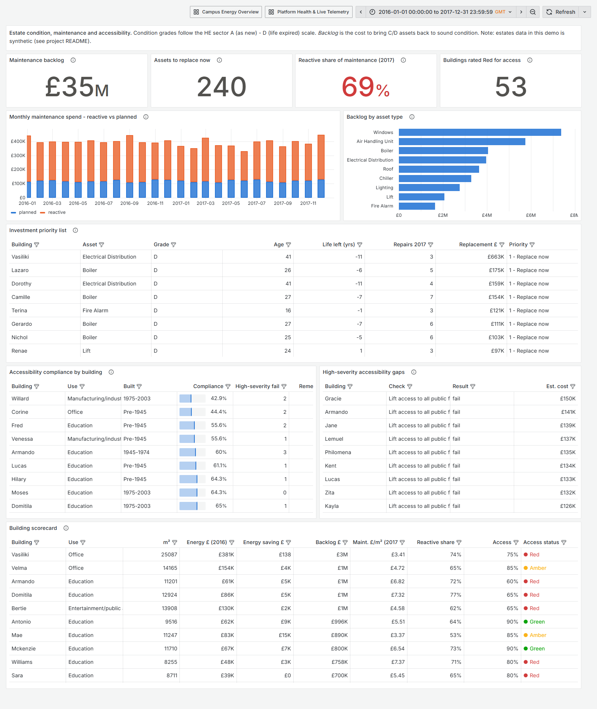
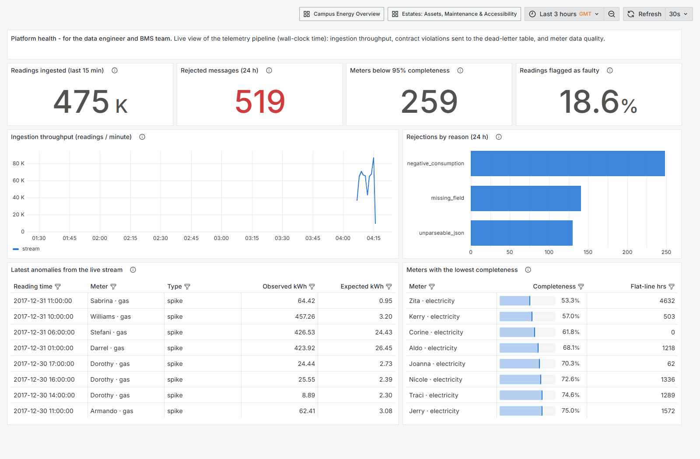

# Smart Campus OT Data Platform

An end-to-end data platform that brings **building-systems (OT) telemetry** and **built-asset data** together so that campus operations teams can answer three questions:

1. **Energy:** where does our energy go, and what could we save? (£ and tCO₂e)
2. **Assets:** which assets are failing, what is the maintenance backlog, and where should capital go first?
3. **Accessibility:** which buildings fall short, and what would it cost to fix them?

The platform is designed for **AWS** (IoT Core → Lambda → Aurora PostgreSQL, defined in **AWS CDK**, and deployed briefly for a live end-to-end run), is **deployed live on Azure** (Container Apps + PostgreSQL, defined in **Bicep**), and runs **entirely locally on free, open-source stand-ins** (Mosquitto, TimescaleDB, SeaweedFS, Grafana). The same ingest code runs in all three.

| | |
|---|---|
| **Data** | 3.87M hourly meter readings from 147 real UK campus buildings ([BDG2](#data-sources), CC BY 4.0) + synthetic CAFM, condition-survey and access-audit data |
| **Headline finding** | **£222k/yr and 1,111 tCO₂e/yr** of out-of-hours energy waste against a £3.87M energy bill. The ten largest opportunities account for 42% of it |
| **Stack** | Python · SQL · dbt · PostgreSQL/TimescaleDB · MQTT · Grafana · Docker · AWS CDK · GitHub Actions |



---

## Architecture



| Concern | AWS design (`infra/`, CDK) | Azure, deployed (`infra-azure/`, Bicep) | Local (`docker-compose.yml`) |
|---|---|---|---|
| Device ingress | IoT Core, X.509 per device, per-building IoT policy | Container App `ingest-api` (HTTPS, gateway batches) | Eclipse Mosquitto |
| Ingest compute | Lambda (Python 3.12, arm64) in private VPC | Same handler in Container Apps (scale to zero) | Same handler via `smart_campus.bridge` |
| Raw landing zone | S3: encrypted, TLS-only, versioned, lifecycle tiers | Blob Storage, managed identity, no shared keys | SeaweedFS (S3 API) |
| Warehouse | Aurora PostgreSQL Serverless v2 | PostgreSQL Flexible B1ms + TimescaleDB | PostgreSQL 16 + TimescaleDB |
| Secrets | Secrets Manager (via VPC endpoint) | Key Vault (RBAC) as source of truth; Container Apps encrypted secrets | `.env` (gitignored) |
| Monitoring / cost | CloudWatch alarms → SNS | Log Analytics (daily cap), budget alert | Grafana *Platform Health* |
| Dashboards | Grafana / QuickSight | Grafana Container App (public, read-only) | Grafana, Metabase |

Why it's built this way is recorded in [Architecture Decision Records](docs/adr/). [ADR 0008](docs/adr/0008-azure-deployment.md) explains how the Azure design works within the subscription's guardrail policies.

---

## How the project maps to the role

| Job requirement | Where to look |
|---|---|
| **OT telemetry pipelines into a Smart Campus platform** | [`simulator.py`](src/smart_campus/simulator.py) → MQTT → [`bridge.py`](src/smart_campus/bridge.py) → [`lambdas/ingest/`](lambdas/ingest/): versioned message contract, raw archive, idempotent upserts, dead-letter table, retry with backoff |
| **AWS: Aurora PostgreSQL, Lambda, IoT Core** | [`infra/smart_campus_infra/platform_stack.py`](infra/smart_campus_infra/platform_stack.py): IoT topic rule with S3 error action, VPC Lambda with reserved concurrency, Aurora Serverless v2, no NAT (VPC endpoints) |
| **Operating a live cloud platform** | [`infra-azure/`](infra-azure/): the same handler and warehouse deployed on Azure with managed identities, Key Vault, a budget alert and scale-to-zero, within existing subscription guardrails ([ADR 0008](docs/adr/0008-azure-deployment.md)) |
| **Infrastructure as code (CDK)** | `infra/`, with [assertion tests](infra/tests/test_platform_stack.py) that enforce security properties (encryption, no public access, TLS-only) |
| **Advanced SQL & data models** | [`warehouse/dbt/`](warehouse/dbt/models): incremental model with late-data lookback, gaps-and-islands stuck-sensor detection, `RANGE` window statistics, peer benchmarking with ordered-set aggregates |
| **Asset condition, maintenance spend, accessibility compliance** | [`marts/estates/`](warehouse/dbt/models/marts/estates): risk-scored investment priority, backlog, reactive-vs-planned spend, SLA, RAG compliance |
| **Quantify energy, cost and performance impacts** | [`mart_out_of_hours_opportunity`](warehouse/dbt/models/marts/energy/mart_out_of_hours_opportunity.sql): peer-benchmarked savings in £ and tCO₂e |
| **Self-service dashboards for non-technical users** | [`dashboards/build_dashboards.py`](dashboards/build_dashboards.py): three role-based dashboards, plain-English descriptions on every panel |
| **Governance, security, documentation** | Least-privilege DB roles ([`db/init`](db/init/001_roles_schemas.sh)); BI sees marts only; 89 dbt tests + source-freshness SLA; dbt docs as the data dictionary; [ADRs](docs/adr/); [runbook](docs/runbook.md) |
| **Explaining technical work to non-technical colleagues** | [Stakeholder brief](docs/stakeholder-brief.md): one page, no jargon |
| **Sound engineering practice** | CI ([`.github/workflows/ci.yml`](.github/workflows/ci.yml)): lint, unit tests, full pipeline integration run, dashboard SQL smoke test as the BI role, CDK tests + synth, Bicep build, container images published to GHCR |

---

## Quickstart

Requirements: Docker with Compose v2, `make`, and about 4 GB RAM for containers. On Windows, run everything from WSL2.

```bash
make env          # create .env from .env.example (then change the passwords)
make data         # download BDG2 source files (~215 MB, once)
make demo         # start stack -> extract -> load -> backfill -> synthetic data -> dbt build
make stream-bg    # replay live telemetry from 2017-07-01 over MQTT
make dbt          # incremental refresh: picks up streamed readings
```

| URL | What |
|---|---|
| http://localhost:3000 | Grafana: *Campus Energy Overview*, *Estates*, *Platform Health* |
| http://localhost:3001 | Metabase (`make bi`, optional): ad-hoc exploration of the `marts` schema |

Other targets: `make test`, `make lint`, `make dashboards` (regenerate and smoke-test), `make dbt-docs`, `make dbt-fresh`, `make psql`, `make nuke` (delete all data). Run `make help` to list them all.

**Deploying to Azure** (free-tier SKUs; resource group `rg-smartcampus-dev`). Run `deploy.sh` where the Azure CLI is logged in, and the `make` targets where Docker runs:

```bash
infra-azure/deploy.sh infra    # PostgreSQL B1ms, Storage, Key Vault, Log Analytics, budget (~10 min)
make azure-demo                # bootstrap DB -> load history + estates data -> dbt build -> dashboard check
infra-azure/deploy.sh apps     # ingest API + Grafana Container Apps (images published to GHCR by CI)
make azure-stream AZ_HOURS=24  # replay a day of telemetry as HTTPS gateway batches
infra-azure/deploy.sh down     # delete everything (asks for confirmation)
```

**Deploying to AWS** (optional, costs money: Aurora and VPC endpoints are billed hourly):

```bash
cd infra && pip install -r requirements.txt
npx aws-cdk@2.170.0 synth -c skip_bundling=true    # inspect the template, no account needed
npx aws-cdk@2.170.0 deploy -c env_name=dev -c alarm_email=you@example.ac.uk
```

After deploying, run `db/init` against the cluster to create the roles and schemas, then point dbt at the cluster endpoint.

---

## What the data says

Full write-up for estates colleagues: [docs/stakeholder-brief.md](docs/stakeholder-brief.md).

- **Energy (2016):** £3.87M and 18,533 tCO₂e across 147 buildings. Teaching buildings use **43% of their electricity outside occupied hours**.
- **Opportunity:** bringing out-of-hours use in line with typical peers saves **£222k and 1,111 tCO₂e a year**, mostly through BMS schedule changes.
- **Maintenance (2017):** **69% of spend is reactive**, against a good-practice target of about 30%. The backlog is **£34.5M**, and **240 critical assets** are rated *replace now*.
- **Accessibility:** **53 buildings are Red**. Lift access is the largest remediation item (£2.1M).
- **Data quality:** **18% of historical readings are flagged and excluded**, mostly long flat-line gap-fills in the source data. These are surfaced on the Platform Health dashboard rather than hidden.

> Estates figures (assets, work orders, audits) come from **synthetic** data generated to plausible sector patterns. Energy figures come from real BDG2 meter data. Tariffs and carbon factors are editable reference data ([`seeds/`](warehouse/dbt/seeds)).

<details>
<summary>Deployed on AWS: CDK stack → IoT Core rule → Lambda → RDS PostgreSQL (brief live demo)</summary>

Deployed with `scripts/aws_demo.sh` on a Free-plan account, verified end to end, then torn down ([ADR 0009](docs/adr/0009-aws-demo-deployment.md)). 24 simulated hours were published over **MQTT/TLS with an X.509 device certificate**. IoT Core invoked the Lambda, which wrote **6,036 readings** to RDS and archived every message to S3. Malformed JSON that IoT Core could not parse was preserved by the rule's S3 error action. On RDS, dbt passed 89/89 and the dashboards show the same figures as locally and on Azure.

The first live run found a real bug that the template tests had missed: the ingest secret was not attached to the database, so it had no host. It was fixed, a regression test was added, and an SQS dead-letter queue was introduced so that failed events can no longer be dropped.

| | |
|---|---|
|  |  |
|  |  |



</details>

<details>
<summary>The same dashboard served live from Azure Container Apps + Azure PostgreSQL</summary>


</details>

<details>
<summary>Estates and Platform Health dashboards</summary>




</details>

---

## Data quality and reliability, by design

| Failure | Defence | Where |
|---|---|---|
| Malformed / impossible messages | Versioned contract; rejected to `raw.telemetry_reject` with a reason | `lambdas/ingest/validation.py` |
| Duplicate or replayed messages | Primary key + `ON CONFLICT` upsert (idempotent) | `sinks.py`, `002_raw_tables.sql` |
| Late or corrected telemetry | Incremental dbt model reprocesses a lookback window | `int_meter_readings_flagged.sql` |
| Spikes, stuck sensors, outages | Trailing-week z-score; gaps-and-islands run length, calibrated on the data ([ADR 0004](docs/adr/0004-data-quality-rules.md)) | `int_meter_readings_flagged.sql` |
| Database outage | Bridge retries with exponential backoff; raw S3 archive allows replay | `bridge.py` |
| Telemetry goes quiet | dbt source freshness; CloudWatch "telemetry silence" alarm | `_sources.yml`, CDK stack |
| Broken dashboards | Every panel's SQL is executed as `bi_reader` in CI | `dashboards/check_dashboards.py` |

The simulator injects these faults on purpose (`SIM_FAULT_RATE`) so every defence is exercised.

---

## Repository layout

```
├── src/smart_campus/      extract, loaders, simulator, MQTT bridge, synthetic data
├── lambdas/ingest/        ingest Lambda (validation, sinks, handler) - same code locally and in AWS
├── db/init/               roles, schemas, raw tables (runs on first DB start)
├── warehouse/dbt/         seeds, staging, intermediate, marts, tests, docs
├── dashboards/            dashboards-as-code generator + SQL smoke test + generated Grafana JSON
├── infra/                 AWS CDK app + template tests
├── infra-azure/           Azure Bicep template + deploy/teardown script
├── docs/                  ADRs, stakeholder brief, runbook, data sources
├── tests/                 unit tests
└── docker-compose.yml · Makefile · .github/workflows/ci.yml
```

## Data sources

- **Building Data Genome Project 2**: Miller, C. et al. (2020), *Scientific Data* 7, 368. Hourly meter data for 1,636 buildings; this project uses site *"Lamb"* (a UK campus, 147 buildings). [GitHub](https://github.com/buds-lab/building-data-genome-project-2), licensed CC BY 4.0.
- **Synthetic estates data**: generated by [`synthetic.py`](src/smart_campus/synthetic.py). Assumptions are in [docs/data-sources.md](docs/data-sources.md).
- **Reference data**: tariffs (assumed contract rates) and UK Government GHG conversion factors, in [`seeds/`](warehouse/dbt/seeds).
